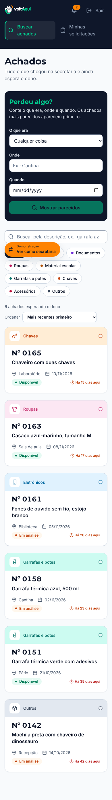
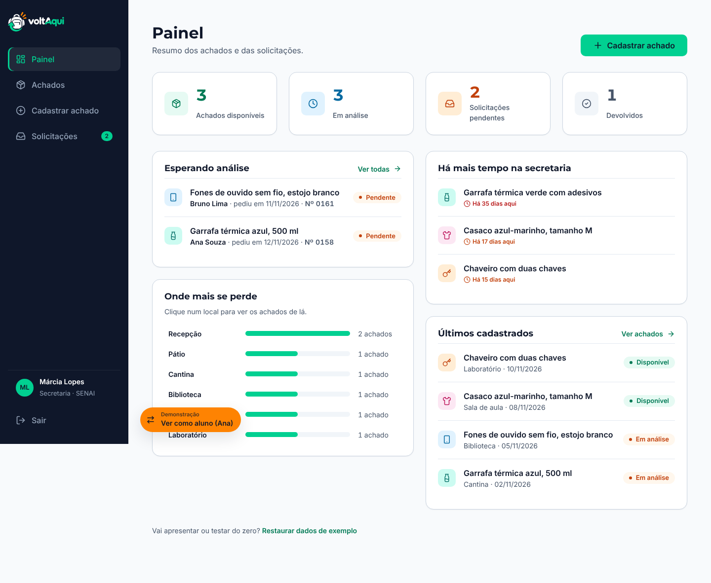
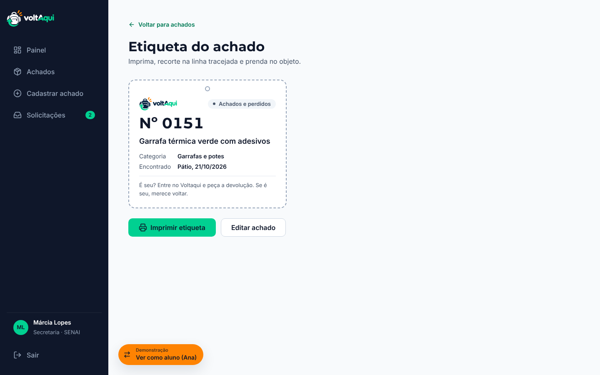
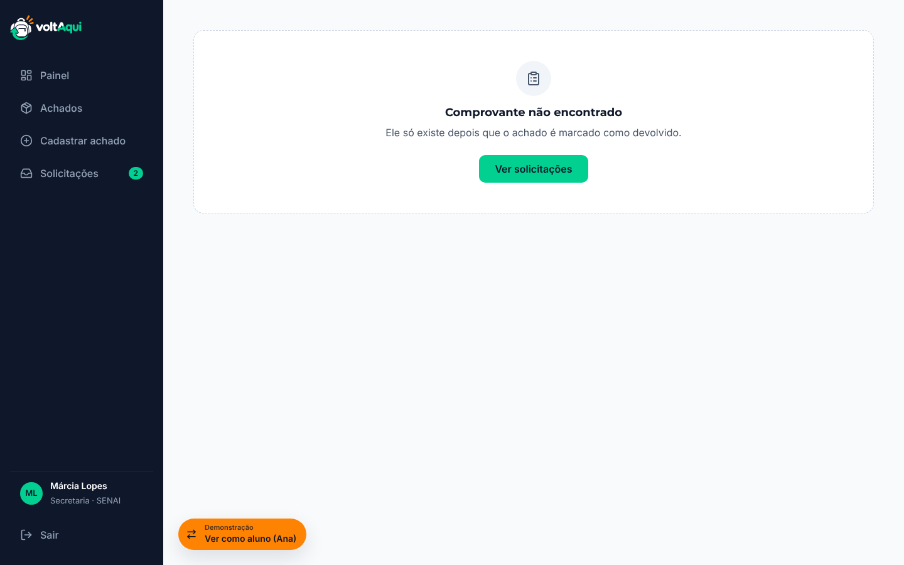

# Voltaqui

**Se é seu, merece voltar.**

Plataforma de achados e perdidos para escolas. A secretaria cadastra o que foi encontrado, o aluno procura pelo celular e pede a devolução, e o objeto só volta para quem prova que é o dono, descrevendo um detalhe que só o dono sabe.

Projeto final do 2º semestre de Desenvolvimento de Sistemas do SENAI.

- **Site publicado:** _link da Vercel aqui_
- **Protótipo no Figma:** https://www.figma.com/design/9VvQYqwe6htzgoCILIAoR3/Voltaqui-%E2%80%94-Design-System-e-Telas

## O problema

Na escola, o que se perde vai parar numa caixa na secretaria. Quem perdeu não sabe que o objeto está lá, a caixa enche e ninguém confere se quem foi buscar é mesmo o dono.

## Como funciona

1. **A secretaria cadastra o achado**: categoria, local, data, uma descrição pública e um **detalhe oculto** (por exemplo: "adesivo de banda na base").
2. **O aluno encontra na lista** e pede a devolução, descrevendo um detalhe do objeto.
3. **A secretaria compara** o que o aluno escreveu com o detalhe oculto e aprova ou recusa.
4. **O aluno retira** na secretaria e o achado é marcado como devolvido.

Cada achado recebe um número (Nº 0158) e uma etiqueta para imprimir e prender no objeto.

| Aluno no celular | Painel da secretaria |
|---|---|
|  |  |

| Etiqueta para imprimir | Comprovante de devolução |
|---|---|
|  |  |

## Funcionalidades

**Principais**
- Cadastro de achados pela secretaria, com validação dos campos, local digitável (com sugestões dos locais já usados) e detalhe oculto
- Busca do aluno pela descrição (sem precisar de acento) e por categoria
- Pedido de devolução descrevendo um detalhe do objeto
- Análise do pedido com pontuação de semelhança: compara o pedido com o detalhe oculto e marca as palavras em comum
- Devolução com comprovante e protocolo `VQ-AAAAMMDD-NNNN`, para imprimir ou salvar em PDF

**Complementares**
- "Perdeu algo?": o aluno diz o que perdeu, onde e quando, e vê os achados mais parecidos primeiro
- Sino de notificações quando a secretaria responde um pedido
- Foto em miniatura do achado, reduzida para poucos KB antes de salvar
- "Há 12 dias aqui" em cada achado, com cor que muda conforme o tempo
- Painel da secretaria com números, pedidos esperando, locais onde mais se perde e itens parados há mais tempo
- Contador de pedidos pendentes no menu
- Botão "Demonstração" (só nas contas de teste) para trocar entre aluno e secretaria na apresentação
- Criar conta com o código da escola (cada escola tem o seu; o do SENAI é `SN7K2P`)
- Página de termos de uso e privacidade, página 404 e layout para computador, tablet e celular

## Tecnologias

- React 19 + JavaScript (ES6+)
- React Router 7 (rotas e páginas protegidas)
- Vite 8
- HTML5 e CSS3 puro, com variáveis de cor e espaçamento (sem framework de CSS)
- localStorage para guardar os dados (não há backend)
- Matter.js para a física da etiqueta na tela de login
- Oxlint para checar o código e Vitest para os testes das funções
- Figma, Git, GitHub e GitHub Projects

## Como rodar

Precisa do [Node.js](https://nodejs.org) 22.12 ou mais novo.

```bash
git clone https://github.com/giovanniprando/trabalho-final-Voltaqui.git
cd trabalho-final-Voltaqui
npm install
npm run dev
```

Abra http://localhost:5173.

Outros comandos:

```bash
npm run build     # gera a versão de produção em dist/
npm run preview   # abre a versão de produção
npm run lint      # confere o código
npm test          # roda os testes das funções de src/utils
```

## Contas de teste

Todas com a senha `123456`. Na tela de login, o botão **"Contas de teste"** entra direto.

| Perfil | E-mail | Nome |
|---|---|---|
| Secretaria | secretaria@senai.br | Márcia Lopes |
| Aluno | ana@aluno.senai.br | Ana Souza |
| Aluno | bruno@aluno.senai.br | Bruno Lima |

O site já começa com 7 achados e 4 pedidos de exemplo. Para voltar a eles, use **"Restaurar dados de exemplo"** no fim do painel da secretaria. As contas criadas e o login continuam.

Cada aba do navegador tem o próprio login. Dá para abrir a secretaria numa aba e o aluno em outra: o que uma aba salva aparece na outra sem recarregar.

## Páginas

| Rota | Quem acessa | Página |
|---|---|---|
| `/` | todos | Homepage |
| `/login` e `/login/secretaria` | todos | Entrar |
| `/criar-conta` | todos | Criar conta de aluno |
| `/termos` | todos | Termos de uso e privacidade |
| `/achados` | aluno | Buscar achados |
| `/achados/:id` | aluno | Detalhe do achado |
| `/achados/:id/solicitar` | aluno | Pedir devolução |
| `/minhas-solicitacoes` | aluno | Meus pedidos |
| `/secretaria` | secretaria | Painel |
| `/secretaria/achados` | secretaria | Lista de achados |
| `/secretaria/novo` | secretaria | Cadastrar achado |
| `/secretaria/editar/:id` | secretaria | Editar achado |
| `/secretaria/solicitacoes` | secretaria | Analisar pedidos |
| `/secretaria/etiqueta/:id` | secretaria | Etiqueta para imprimir |
| `/secretaria/comprovante/:id` | secretaria | Comprovante de devolução |
| qualquer outra | todos | Página não encontrada (404) |

## Estrutura

```
src/
├── components/   peças reutilizáveis (SeloStatus, Campo, Modal, barra lateral...)
├── context/      login, dados e avisos compartilhados entre as páginas
├── data/         categorias, sugestões de locais, escolas, contas e dados de exemplo
├── hooks/        useTitulo (título da aba)
├── lib/          física da etiqueta (Matter.js, carregado só quando precisa)
├── pages/        páginas públicas, aluno/ e secretaria/
├── services/     storage.js: único arquivo que lê e grava no navegador
├── styles/       CSS de cada página, dos componentes e das fontes
└── utils/        validações, datas, formatação, semelhança, parecidos, ordenação, foto e testes

public/fontes/    Inter e Montserrat salvas no projeto (sem Google Fonts)
prototipo/        as telas feitas primeiro em HTML e CSS, antes do React
docs/             prints de antes e depois da revisão e o relatório da revisão
```

### Como os dados ficam salvos

Tudo fica no localStorage do navegador, sempre passando pelo `src/services/storage.js`. O login fica no sessionStorage (um por aba).

- **Achado**: número, categoria, descrição, detalhe oculto, local, data, foto e status (`disponivel` → `em_analise` → `devolvido`)
- **Pedido**: achado, aluno, o que o aluno descreveu e status (`pendente`, `aprovada`, `recusada`)

Regras:
- Um pedido novo coloca o achado em análise.
- Enquanto os pedidos estão pendentes, outros alunos também podem pedir. A secretaria compara e aprova o dono.
- Aprovar um pedido recusa os outros pendentes do mesmo achado, e esses alunos recebem a notificação. Um achado nunca tem dois pedidos aprovados.
- Com um pedido aprovado, ninguém mais pede o achado, nem digitando o endereço da página.
- Cada aluno pede o mesmo achado uma vez só. Se o pedido for recusado, ele não pode pedir de novo: se pudesse, daria para chutar detalhes até acertar. Ele procura a secretaria.
- Se o pedido é recusado e não há outro em aberto, o achado volta a ficar disponível.
- Só achado com pedido aprovado pode ser marcado como devolvido.
- Editar ou excluir um achado com pedido aprovado mostra um aviso antes, porque o aluno ainda vai retirar.
- Excluir um achado apaga também os pedidos dele.
- O número do achado nunca se repete, mesmo depois de excluir ou de restaurar os dados de exemplo.
- Palavras do detalhe oculto que também estão na descrição pública não contam na semelhança (o aluno poderia copiar da tela).
- Datas sempre no fuso de quem usa: um achado de 20/10 aparece como 20/10, e depois das 21h "hoje" continua sendo hoje.

## Testes feitos

Todos rodados no Chrome em 1440 px e em 390 px, no fuso de São Paulo.

| O que testamos | Esperado | Resultado | Passou? |
|---|---|---|---|
| Entrar com senha errada | Mostra "E-mail ou senha não conferem" | Mostrou a mensagem | Sim |
| Entrar com conta da secretaria na aba Aluno | Avisa para usar a outra aba | Avisou | Sim |
| Abrir página interna sem login | Volta para o login | Foi para `/login` | Sim |
| Criar conta com código errado, e-mail repetido e senhas diferentes | Mostra o erro em cada campo | Três erros na tela | Sim |
| Busca por "termica", "TERMICA", "térmica" e " termica " | As quatro encontram as 2 garrafas térmicas | 2, 2, 2 e 2 resultados | Sim |
| Filtrar por categoria sem resultado | Mostra a mensagem e o botão de limpar | Mensagem e botão na tela | Sim |
| "Perdeu algo?" com garrafa, pátio e 20/10 | A garrafa do pátio aparece primeiro como "Muito parecido" | Garrafa verde do pátio em primeiro | Sim |
| Achado de 21/10 na lista, no detalhe e na etiqueta | 21/10 em todo lugar (não 20/10) | 21/10/2026 nos três | Sim |
| Cadastrar achado com a data de hoje às 21h30 | Aceita e mostra o dia certo | Campo veio com 25/11 e a etiqueta mostra 25/11/2026 | Sim |
| Protocolo de devolução feita às 21h30 | Usa o dia local | `VQ-20261125-0163` | Sim |
| Cadastrar achado com campos vazios e data no futuro | Erro em cada campo e não salva | Erros na tela, continuou no formulário | Sim |
| Cadastrar o local "  cantina " quando já existe "Cantina" | Salva como "Cantina" e abre a etiqueta com o próximo número | Etiqueta Nº 0166, local "Cantina" | Sim |
| Excluir o achado de número mais alto e cadastrar outro | O número não se repete | Veio Nº 0167 | Sim |
| Editar achado | O formulário vem preenchido e salva as mudanças | Veio preenchido e salvou | Sim |
| Excluir achado | Pede confirmação; some da lista junto com os pedidos | Confirmou e sumiu | Sim |
| Caixa de confirmação pelo teclado | Prende o foco, fecha com Esc e devolve o foco ao botão que abriu | Tudo certo | Sim |
| Pedido com menos de 10 letras, com espaços nas pontas e só com números | Erro nos três casos | Erro nos três | Sim |
| Pedido com 10 letras exatas | Aceita | Aceitou | Sim |
| Dois alunos pedem o mesmo achado e a secretaria aprova um | O outro fica recusado e recebe notificação | Bruno recusado, sino com 1 nova | Sim |
| Secretaria aprova o pedido da Ana | O sino da Ana mostra 1 notificação nova | "Notificações, 1 novas" | Sim |
| Aluno digita `/achados/:id/solicitar` de achado reservado ou que já pediu | Volta para o detalhe com o motivo | Voltou e explicou nos dois casos | Sim |
| Aprovar, recusar e marcar devolvido | Status, contador do menu e painel mudam juntos | Contador foi de 2 para 1; comprovante abriu | Sim |
| Recarregar a página | Nada se perde | O comprovante continua | Sim |
| Pedido "adesivo de uma banda" contra o detalhe "Adesivo de banda na base" | Alta semelhança, com as palavras em comum marcadas | Alta, palavras marcadas | Sim |
| Pedido que copia a descrição pública | Não ganha pontos | 0 palavras em comum; as copiadas aparecem como "não contam" | Sim |
| Duas abas abertas (secretaria e aluno) | A aprovação aparece na outra aba sem recarregar | Apareceu; cada aba continuou com o próprio usuário | Sim |
| localStorage com texto inválido | O site abre e volta aos dados de exemplo | Abriu com os exemplos | Sim |
| Restaurar dados de exemplo | Achados e pedidos voltam; contas criadas e login continuam | Continuou logada; a conta criada continuou | Sim |
| `/achados/999`, `/secretaria/editar/999` e `/nada` | "Não encontrado", sem quebrar | Mensagem nos três | Sim |
| Aluno abre `/secretaria/achados` | Volta para a lista de achados | Foi para `/achados` | Sim |
| Sair e apertar Voltar no navegador | Não mostra página protegida | Ficou no login | Sim |
| Etiqueta do login no modo de desenvolvimento | Uma etiqueta e um barbante só | 1 e 1 | Sim |
| Etiqueta do login com "reduzir movimento" ligado | Fica parada | Parada; o Matter.js nem é baixado | Sim |
| Foto: PDF, HEIC do iPhone e imagem de 16 MB | Aviso claro, a página não trava | Um aviso para cada caso | Sim |
| Foto de 1600 × 1200 no cadastro | Vira uma miniatura de poucos KB | 1 KB | Sim |
| Armazenamento do navegador cheio | Aviso na tela e nada quebra | Aviso apareceu e o formulário continuou | Sim |
| Navegar a homepage só com Tab | O foco é sempre visível | Todas as paradas com anel de foco | Sim |
| Etiqueta e comprovante no Ctrl+P | Sem menu, barra lateral ou botões; cabem numa A4 | Uma página A4 cada, só o conteúdo | Sim |
| Telas em 1440 e 390 px | Nada passa da largura da tela | 11 páginas sem rolagem lateral | Sim |
| Celular de verdade: login, busca, pedido e painel | Funciona sem travar | _a fazer pela equipe_ | |

Lighthouse na versão de produção (`npm run build && npm run preview`), homepage, login e criar conta: **Desempenho 100, Acessibilidade 100, Boas práticas 100, SEO 100**.

Além do teste no navegador, `npm test` roda 17 testes automáticos das funções de `src/utils` (datas, busca, semelhança, parecidos, ordenação e validações).

## Limitações

O Voltaqui é uma demonstração sem servidor. Isso tem consequências que a gente conhece:

- **Os dados ficam só no navegador de quem usa.** O que a secretaria cadastra no computador dela não aparece no celular do aluno. Na apresentação, tudo roda no mesmo navegador.
- **As senhas não são criptografadas.** Elas ficam como texto no localStorage.
- **O controle de perfil e o detalhe oculto ficam no navegador.** A tela do aluno não mostra o detalhe oculto, mas qualquer pessoa que abrir o DevTools consegue ver ou mudar os dados, inclusive trocar de perfil.

Próximo passo para uso real: um servidor com banco de dados e login de verdade (senha com hash, sessão no servidor). O servidor guardaria o detalhe oculto e só mandaria para o navegador da secretaria, e faria a comparação de semelhança do lado dele.

## Organização

- **Branches:** `main` (versão estável), `develop` (integração) e uma branch por integrante. Tudo entra na `develop` por Pull Request.
- **Kanban:** GitHub Projects com as colunas A fazer, Em andamento, Em revisão e Concluído.
- **Fluxo:** as telas do sistema foram feitas primeiro no Figma, depois em HTML e CSS (`prototipo/`) e por fim em React. A homepage foi desenhada direto em HTML e CSS.

## Equipe

- [Giovanni Prando](https://github.com/giovanniprando)
- Danilo _(nome completo e link do GitHub)_
- Renan _(nome completo e link do GitHub)_

Orientação: prof. Johnny Braga de Oliveira, SENAI.
